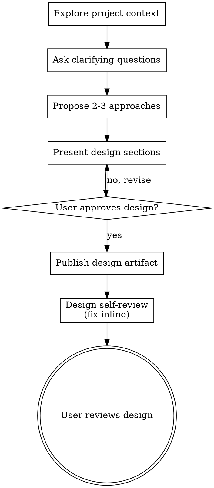

Adapted from [obra/superpowers](https://github.com/obra/superpowers) 6.2.0, `skills/brainstorming/SKILL.md` at commit `44c9b2d6e889982ac18c27d05a19fefe335194e1`. MIT License, Copyright (c) 2025 Jesse Vincent.

If `repo.md` sits next to this file, or `.claude/eng/gather-design/repo.md` exists in this repo, read it first. It holds this repo's commands and conventions. Where it conflicts with this skill, follow it.

# Brainstorming Ideas Into Designs

Help turn ideas into fully formed designs through natural collaborative dialogue.

Start by understanding the current project context, then ask questions one at a time to refine the idea. Once you understand what you're building, present the design and get user approval.

Two documents come out of this, in separate turns. The **design** says what we're building, which blocks hold it, and the PR stack it splits into. The **plan** is written after the user approves the design, and spells out every PR as diffs with a test plan.

<HARD-GATE>
Do NOT invoke any implementation skill, write any code, scaffold any project, or take any implementation action until you have presented a design and the user has approved it. This applies to EVERY project regardless of perceived simplicity.
</HARD-GATE>

## Anti-Pattern: "This Is Too Simple To Need A Design"

Every project goes through this process. A todo list, a single-function utility, a config change — all of them. "Simple" projects are where unexamined assumptions cause the most wasted work. The design can be short (a few sentences for truly simple projects), but you MUST present it and get approval.

## Checklist

You MUST create a task for each of these items and complete them in order:

1. **Explore project context** — check files, docs, recent commits, and the repo's architecture doc if it has one
2. **Ask clarifying questions** — one at a time, understand purpose/constraints/success criteria
3. **Propose 2-3 approaches** — with trade-offs and your recommendation
4. **Present design** — in sections scaled to their complexity, ending with the PR stack, get user approval after each section
5. **Publish the design artifact** — the whole design as one page, linked on the ticket (see below)
6. **Design self-review** — quick inline check for placeholders, contradictions, ambiguity, scope (see below)
7. **User reviews the artifact** — give the link and stop

## Process Flow



**The terminal state is the user reading the design artifact.** Do NOT write the plan or invoke any implementation skill. The plan starts in a later turn, after the user has read the design and said so.

## The Process

**Understanding the idea:**

- Check out the current project state first (files, docs, recent commits)
- Before asking detailed questions, assess scope: if the request describes multiple independent subsystems (e.g., "build a platform with chat, file storage, billing, and analytics"), flag this immediately. Don't spend questions refining details of a project that needs to be decomposed first.
- If the project is too large for a single design, help the user decompose into sub-projects: what are the independent pieces, how do they relate, what order should they be built? Then brainstorm the first sub-project through the normal design flow. Each sub-project gets its own design → plan → implementation cycle.
- For appropriately-scoped projects, ask questions one at a time to refine the idea
- Prefer multiple choice questions when possible, but open-ended is fine too
- Only one question per message - if a topic needs more exploration, break it into multiple questions
- Put the research the question rests on in the same message, as one block: what the code does today with `file:line`, what the answer hinges on, then the question. Text scattered between earlier tool calls in the turn may never render for the user.
- Use `AskUserQuestion` only when the options are self-explanatory without context. A decision that needs the research on screen next to it goes in plain text at the end of the message, with no question tool.
- Skip any question the code can answer
- Focus on understanding: purpose, constraints, success criteria

**Exploring approaches:**

- Propose 2-3 different approaches with trade-offs
- Each approach says which architecture block holds the logic and why (see below)
- Present options conversationally with your recommendation and reasoning
- Lead with your recommended option and explain why
- YAGNI ruthlessly - remove unnecessary features from every approach and design. No opt-in flags, no escape hatches, no speculative generality.

**Presenting the design:**

- Once you believe you understand what you're building, present the design
- Scale each section to its complexity: a few sentences if straightforward, up to 200-300 words if nuanced
- Ask after each section whether it looks right so far
- Cover: architecture, components, data flow, error handling, testing, and last the PR stack
- Be ready to go back and clarify if something doesn't make sense

**Design with architecture blocks:**

The design is built from these blocks. The questions to ask of every piece of logic, in order:

1. **Which model does this belong to?** Business logic goes on the model first. A model can call other models, repos, and services.
2. **Is a primitive standing in for a thing?** A field with helpers around it becomes a value object (`Email`, `DateRange`). A group of models with a shared invariant becomes an aggregate, and outside code talks to its root only.
3. **Does it manage a collection or cross the storage boundary?** Then it goes on that model's repo. A model has at most one repo on the frontend and one on the backend. A repo that manages two models, or one that knows about a downstream feature (`OrderRepo` knowing about loyalty points), is the smell to fix.
4. **Is there no single owner?** A stateless, noun-named service coordinates the repos (`RefundIssuingService`, `Checkout.byGiftCard`). Reach for this last.
5. **Is it UI state or UI-only logic?** A presenter, one per rendered component.

Rules that follow:

- Every new file maps to one block: model, value object, aggregate, repo, service, presenter, view helper. A bag of callbacks or a `utils` file is none of these. List each new file with its block before presenting the design.
- Use the domain's words. The name in the UI, the code, and the DB is the same name.
- Controllers and presenters may touch models directly. No layered architecture, no CQRS, no domain events, no "application layer" vocabulary.
- Grep every helper name the design uses before writing it down.

**Design for isolation and clarity:**

- Break the system into smaller units that each have one clear purpose, communicate through well-defined interfaces, and can be understood and tested independently
- For each unit, you should be able to answer: what does it do, how do you use it, and what does it depend on?
- Can someone understand what a unit does without reading its internals? Can you change the internals without breaking consumers? If not, the boundaries need work.
- Smaller, well-bounded units are also easier for you to work with - you reason better about code you can hold in context at once, and your edits are more reliable when files are focused. When a file grows large, that's often a signal that it's doing too much.

**Working in existing codebases:**

- Explore the current structure before proposing changes. Follow existing patterns.
- Where existing code has problems that affect the work (e.g., a file that's grown too large, unclear boundaries, tangled responsibilities), include targeted improvements as part of the design - the way a good developer improves code they're working in.
- Don't propose unrelated refactoring. Stay focused on what serves the current goal.

## PR Stack

The design ends with the PR stack, bottom up. It shows how the design splits into reviewable pieces. A feature that can't land without dragging a refactor or a fix along with it is a design problem, and the stack is where it shows up. The plan may re-cut the stack and says why when it does.

Each line has the kind, which is the type that opens the title, then a title in PR-title form and one sentence on what the PR does. No diffs or size estimates.

Read the `pr-stack` skill for the kinds and what never shares a PR.

## Design Artifact

The artifact is the design doc. Reviewers read it and the `gather-plan` skill reads it, so everything the design settled goes in it. Don't keep a separate markdown doc.

Publish it with the `Artifact` tool after loading the `artifact-design` skill. Write the page to `.repo/local/tmp/<YYYY-MM-DD>-<team>-<number>-<slug>-design.html`, e.g. `2026-09-30-abc-1234-order-history-design.html`. Resolve the repo root with `git rev-parse --show-toplevel`. The team prefix matches the ticket (`abc-`, `ops-`).

The page carries, top to bottom:

- A lede naming the ticket and the problem, plus a legend when the figures use color.
- One to three figures: how it works today, what the change does, and where the two differ. Hand-drawn SVG, boxes named after the real symbols, `file:line` where it helps. Red for the path that loses the failure, blue for what moves or is added, dashed for optional.
- The approach, and each new file with its block.
- A class diagram of the classes the design touches and how they call each other (see below).
- The schema changes when the design adds or changes storage: tables, columns, indexes, Redis keys.
- A table per axis the design settles, e.g. outcomes per version, which layers fire on one failed tap, the rules.
- A numbered Decisions table with the reason for each judgment call.
- The PR stack, bottom up, one line each.
- Rejected options with the reason, last.

### Class diagram

The class diagram reminds the reader how the system fits together. It shows every class the design adds or changes, from presenters down to value objects. It also shows the ones a reader needs to follow the flow.

- Each box has the class name, a short summary in italics, then the members the design reads or changes. The summary says what the class does here or why it matters to this design. It can run to two or three lines when one won't do. A bare name isn't enough, because two repos with similar names read the same until you open both.
- Rows follow the blocks: presenters on top, repos and services in the middle, models and value objects at the bottom.
- Arrows point from the caller to what it calls, each with a short verb label like `reads`, `queries` or `sets target`.
- Blue boxes are new, and blue members are new or changed.
- The caption says how to read the diagram, e.g. which flow runs down which side.

When two classes look like they overlap, add a short note under the diagram on where they split. Follow it with a table of questions a reader would ask and the class and member that answers each.

Hand-placed SVG text clips. Size each box from its longest line, at 0.6em per monospace character plus padding. Put edge labels beside the line, never on it. Before every publish, run the checker and fix every finding:

```bash
node <skill-dir>/checkArtifact.ts <artifact.html>
```

`<skill-dir>` is this skill's base directory. It renders the page at 1280px and 390px. It flags text spilling out of its box, a line through a label, and overlapping text. It also flags clipped HTML and sideways scroll. Open the screenshots it writes, since it can't judge spacing or legibility.

No code and no diffs. A signature or a type shape is fine where the design turns on it. No open questions left on the page. Republish to the same URL so every iteration keeps the link.

Right after the first publish, add the URL to the ticket's links if your tracker is connected.

The Artifact tool publishes private and has no sharing parameter, so the User Review Gate tells the user to share it. Redeploys keep their sharing.

## After the Design

**Design Self-Review:**
After publishing, read the page with fresh eyes:

1. **Placeholder scan:** Any "TBD", "TODO", incomplete sections, or vague requirements? Fix them.
2. **Internal consistency:** Do any sections contradict each other? Does the architecture match the feature descriptions?
3. **Scope check:** Is this focused enough for a single design, or does it need decomposition?
4. **Ambiguity check:** Could any requirement be interpreted two different ways? If so, pick one and make it explicit.
5. **Block check:** Does every new file map to one block? Does the logic sit on a model before a service? Does every class on the diagram have a summary? Fix the design.
6. **Stack check:** Does any PR mix kinds, or split one idea in two? Fix the stack.

Fix any issues and republish. No need to re-review — just fix and move on.

**User Review Gate:**
After the self-review passes, give the user the link and stop:

> "Design published to `<url>`."

When this turn first published the artifact, the message's last line is this one, verbatim and on its own:

> "Remember to share the artifact: open the link, click Share, and pick who can see it."

It goes after the stack, saved memories, and anything else in the message. Don't fold it into the line that gives the artifact link.

Don't call ExitPlanMode. The user reviews the artifact on their own terms. Answer a question or a comment on the artifact in chat. Edit the page only for notes that are plain instructions, or once the user decides.

## Writing the Plan

Once the user approves the design, the `gather-plan` skill writes the plan in a later turn.
